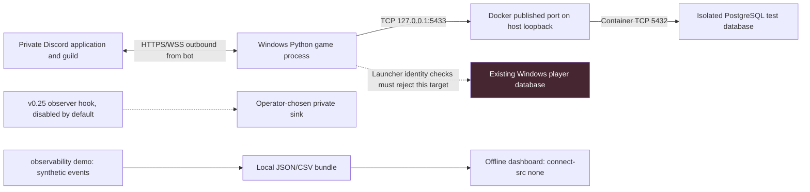

# Network architecture: private gameplay and offline monitoring

## Known environment versus unverified runtime

The user-reported private gameplay endpoint is IPv4 loopback `127.0.0.1:5433`,
database `dao_playtest_v023_rc1`, dedicated login `dao_playtest_rc1`, Docker
PostgreSQL 18.6 and recorded cluster identifier `7699864005918920747`. These come
from the playtest report, not from newly queried live evidence. Listeners, port
publication, container health and database availability were not inspected
during this offline cycle.

The bot opens only outbound connections (to Discord over TLS and to PostgreSQL
on loopback); it listens on no port. The lab has no network path at all: the CLI
reads and writes local files, and the dashboard's Content Security Policy sets
`connect-src 'none'`.

## TCP/IP and loopback

- `127.0.0.1` is IPv4 loopback on the machine running the client. Inside a
  container, loopback is that container, not the Windows host or another
  container.
- `localhost` may resolve to IPv6 `::1` first. A service published only on IPv4
  loopback then looks "refused". The launcher uses the literal IPv4 address.
- A TCP endpoint (address plus port) selects a socket, not a database. A
  successful handshake does not establish which cluster, database, role or schema
  answered. The private launcher separately checks the recorded cluster identity,
  database name, dedicated role and isolation rules before gameplay starts.
- Port `5433` keeps the Docker database apart from a customary `5432` install.
  The port number is not a safety control; any process can occupy either port.
- `observability/lab_config.json` mirrors this: `validate_lab_config` accepts
  only literal `127.0.0.1`, a PostgreSQL port from 1024 to 65535 marked
  `tcp-description-only`, passive application and container targets with no
  port, and `network_probes_enabled: false`. There is no probe runner.

## Docker networking and published ports

- Containers on a Docker bridge network get private addresses; the host reaches
  them through **published ports**. `-p 127.0.0.1:5433:5432` binds the host side
  to loopback only. `-p 5433:5432` with no address binds every host interface,
  which would expose the database to the LAN; never use it for this lab.
- The expected mapping is host `127.0.0.1:5433` to container `5432`. It must be
  confirmed by the authorized `docker ps` check in the [runbook](RUNBOOK.md)
  before relying on it; this document is not an inspection receipt.
- Loopback publishing limits *remote* reach. Other local processes and users can
  still connect, so authentication remains required.
- A Compose service name (for example `db`) resolves through Docker's embedded
  DNS only for containers on the same user-defined network. The Windows launcher
  is not on that network and must not use it. No DNS server, hostname, container
  name or Compose project name is assumed here.

## PostgreSQL authentication boundaries

Reaching the port is the first of several independent gates:

1. **Listener**: `listen_addresses` and the published port decide who can open TCP.
2. **Client authentication**: `pg_hba.conf` rules match connection type, database,
   role and source address and choose a method (ideally `scram-sha-256`).
   Failures surface as SQLSTATE `28P01` or `28000`.
3. **Role and privileges**: the dedicated `dao_playtest_rc1` login should own or
   be granted only the playtest database, without superuser rights. A `42501`
   SQLSTATE means the role lacks a privilege.
4. **Identity**: the launcher compares the cluster system identifier and database
   name with recorded values, so a different server on the same port is refused.

These are design expectations for the operator; this cycle did not read
`pg_hba.conf`, list roles or run SQL. Troubleshooting never justifies changing
grants, resetting schemas or using an administrator login.

## Observability boundary

The observability package contacts nothing: health is computed from events
(`probe_mode: passive_only`), and stale or missing services are `unknown`. Any
future connectivity check would need to be explicit, one-shot, allowlisted,
short-lived and must report TCP reachability separately from authenticated SQL
readiness. Prometheus and Grafana would add listeners, volumes and credentials
to a single private process; local versioned events are enough for this lab.
